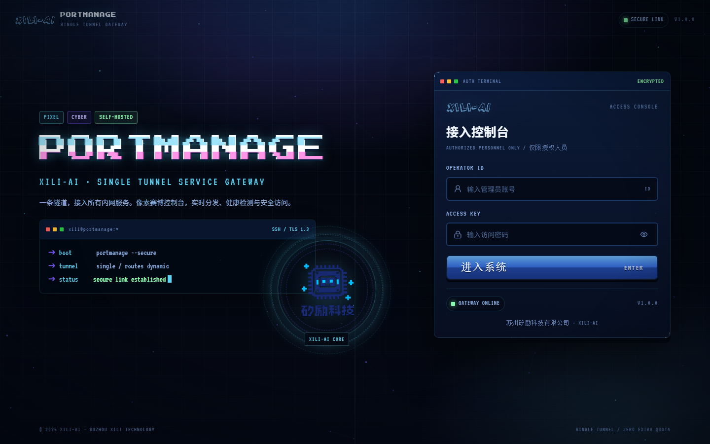
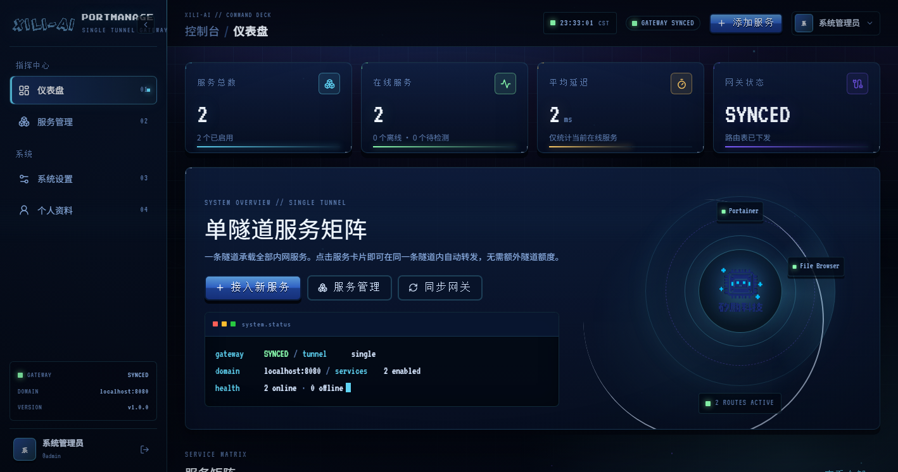
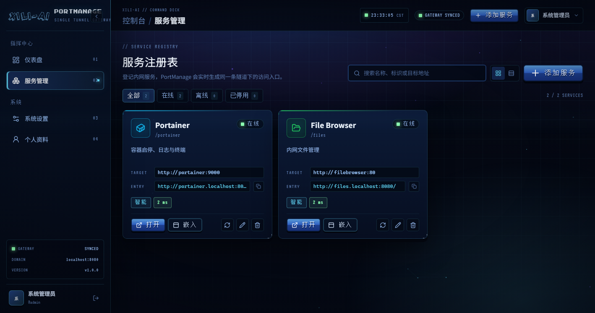
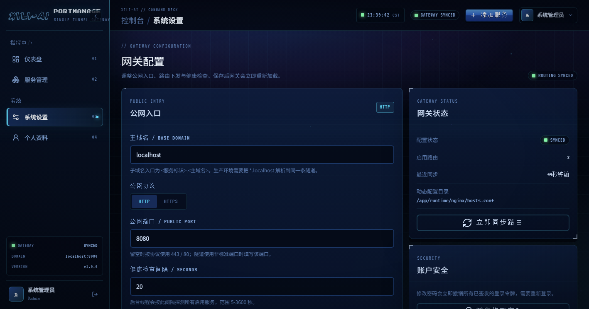
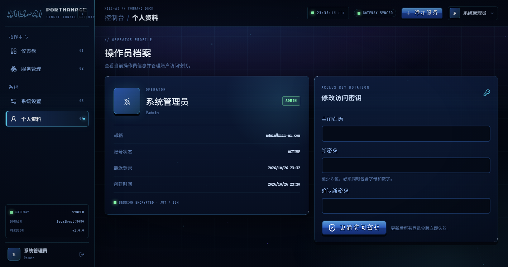
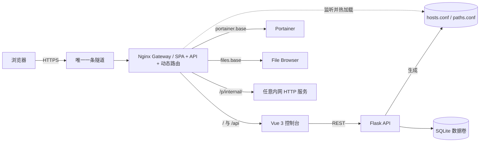

# 矽励科技服务网关管理系统

一条隧道，接入所有内网服务。像素赛博风格的自托管服务网关与控制台。

`Vue 3` · `TypeScript` · `Flask` · `SQLAlchemy` · `Nginx` · `Docker`



---

## 为什么是服务网关

内网穿透通常按「隧道」计费，但一个团队往往有几十个 HTTP 服务：Portainer、文件管理、监控、测试环境、内部工具……如果每个服务都占一条隧道，成本和维护都会失控。

服务网关把**一条隧道**变成整个内网的服务入口：

- 隧道只指向服务网关。
- 面板里登记服务，网关立即生成子域名或路径入口。
- 点击卡片直接转发到目标服务，不复制 `localhost`，不额外创建隧道。
- 增删改查即时生效，网关热加载，无需重启容器。

> HTTP/HTTPS 服务走网关路由；SSH、RDP、数据库等非 HTTP 服务走内置的 WebSocket 隧道入口，
> 同样只用这一条隧道，见 [docs/TUNNEL.md](docs/TUNNEL.md)。

## 功能

- **单隧道多服务**：同一个 HTTPS 入口承载全部 HTTP 服务。
- **单隧道全协议**：内置 wstunnel，SOCKS5 / 本地端口转发访问 SSH、RDP、数据库，不需要 DNS 或第二条隧道。
- **多用户与授权**：管理员管理账号和服务可见范围；普通用户只能打开被授权的入口。
- **动态服务注册表**：新增、编辑、删除服务后自动重新生成 Nginx 路由。
- **双路由模式**：
  - 子域名：`portainer.example.com`，兼容性最好，推荐生产使用。
  - 路径：`https://example.com/p/portainer/`，无需泛解析；网关自带根绝对资源、重定向和 Cookie 兼容层。
  - 直连：不生成路由，卡片直接打开源站地址；适合把根路径写死在 JS 里的应用，远程需 wstunnel 客户端（SOCKS 或端口转发）。
- **可选入口路径**：应用 UI 不在根路径时可填 `/dashboard` 等路径（例如 Qdrant Web UI）。
- **本地零配置调试**：本机访问控制台时自动使用 `*.localhost`（如 `http://files.localhost:8080/`）。
- **健康检查**：后台线程定期探测服务，面板展示在线状态与延迟。
- **安全登录**：JWT、密码哈希、失败锁定、登录限流、令牌版本撤销。
- **审计流**：登录、服务变更、设置修改全部记录，仪表盘展示最近事件。
- **像素赛博 UI**：公司 XILI-AI 品牌、像素字体、扫描线、全息环、动效登录页。
- **一键部署**：Docker Compose + 可选 Portainer / File Browser 示例服务。

## 界面

| 仪表盘 | 服务管理 |
| --- | --- |
|  |  |

| 网关配置 | 操作员档案 |
| --- | --- |
|  |  |

## 架构



核心设计：

1. **Nginx 是唯一入口**。控制台、API 和服务流量都由它分发。
2. **Flask 只管理状态**。服务、设置、用户、审计写入 SQLite，并生成 Nginx 路由片段。
3. **文件监听热加载**。网关每秒检查 `hosts.conf` / `paths.conf` 的哈希，先 `nginx -t` 再 reload；配置错误时保留旧路由。
4. **前端完全分离**。Vue SPA 构建后由 Nginx 静态托管，通过 `/api` 访问 Flask。

更完整的设计说明见 [docs/ARCHITECTURE.md](docs/ARCHITECTURE.md)。

## 快速开始

### 1. 准备环境

- Docker 24+ / Docker Compose v2
- 一条已经可用的内网穿透 HTTPS 隧道
- 生产环境建议准备一个可配置泛解析的域名

### 2. 配置

```powershell
Copy-Item .env.example .env
Copy-Item dev.backend.env.sample dev.backend.env
```

编辑 `.env`：

```dotenv
APP_ENV=dev
GATEWAY_PORT=8080
COMPOSE_PROFILES=demo   # 可选：同时启动 Portainer / File Browser
```

编辑 `dev.backend.env`，至少修改：

```dotenv
JWT_SECRET_KEY=<openssl rand -hex 32>
ADMIN_PASSWORD=<至少 8 位，包含字母和数字>
BASE_DOMAIN=localhost
PUBLIC_SCHEME=http
# 留空 = 使用浏览器实际使用的公网端口；本地回环入口仍使用 8080
PUBLIC_PORT=
```

生产环境使用 `APP_ENV=pro` + `pro.backend.env`，并把 `BASE_DOMAIN` 改成真实域名、`PUBLIC_SCHEME=https`、`PUBLIC_PORT` 留空（443）。

### 3. 启动

```powershell
docker compose -f docker/app/docker-compose.yml up -d --build
docker compose -f docker/app/docker-compose.yml ps
```

首次启动会自动创建数据库、管理员和两个示例服务（Portainer / File Browser）。打开：

```text
http://localhost:8080
```

账号密码来自 `dev.backend.env` 的 `ADMIN_USERNAME` / `ADMIN_PASSWORD`。
完整的密码来源、修改和重置方式见 [docs/CREDENTIALS.md](docs/CREDENTIALS.md)，
或运行 `.\scripts\show-credentials.cmd` 查看当前配置值。

### 4. 接入你的隧道

把隧道的本地目标改为：

```text
127.0.0.1:8080
```

如果使用其他端口，把 `.env` 的 `GATEWAY_PORT` 改成同一个值。**仍然只使用这一条隧道。**

非 HTTP 服务（SSH / RDP / 数据库）不需要第二条隧道：在 `.env` 设置 32 位十六进制的
`TUNNEL_SECRET`，重建网关并启动 `tunnel` 服务，然后用客户端脚本在本机开 SOCKS5：

```powershell
docker compose -f docker/app/docker-compose.yml up -d --build gateway
docker compose -f docker/app/docker-compose.yml up -d tunnel
.\scripts\tunnel-client.cmd -Secret <TUNNEL_SECRET>
```

> `.\scripts\tunnel-client.ps1` 只在仓库根目录成立。其他目录请用绝对路径，
> 或直接运行 `scripts\tunnel-client.cmd`（同参数）。入口是自签名证书时
> （`curl: (60) SEC_E_UNTRUSTED_ROOT`）加 `-Insecure`。

客户端会带 `TUNNEL_SECRET` 读取服务表，为每个服务自动建立 `127.0.0.1:181xx` 本地入口
（面板卡片上的「本地」按钮），应用在根路径运行，适合写死根路径的 SPA。
详见 [docs/TUNNEL.md](docs/TUNNEL.md)。

### 5. 接入服务

在面板点击「添加服务」，填写：

| 场景 | 目标地址 |
| --- | --- |
| Docker 容器 | `http://portainer:9000`、`http://my-app:8080` |
| Windows / Linux 宿主机 | `http://host.docker.internal:8181` |
| 局域网其他机器 | `http://192.168.1.10:8181` |
| UI 不在根路径（如 Qdrant） | 目标填 `http://host.docker.internal:6333`，入口路径填 `/dashboard` |

目标地址只填写协议、主机和端口，不支持路径前缀；应用 UI 不在根路径时用「入口路径」补充。保存后路由立即生效。

## 路由模式

### 子域名（推荐）

访问地址：

```text
https://<服务标识>.<BASE_DOMAIN>/
```

生产环境需要把 `*.<BASE_DOMAIN>` 解析到**同一条隧道**的入口。泛解析不会额外占用隧道额度。

本机调试时自动使用：

```text
http://<服务标识>.localhost:8080/
```

Chromium / Edge 会把 `*.localhost` 解析到回环地址。

通过隧道访问时，如果 `BASE_DOMAIN` 还是开发默认的 `localhost`，控制台会从当前访问域名推断泛域名根（例如 `www.example.com` -> `example.com`）。如果隧道入口是多级子域（例如 `abc.example.com`），请在「系统设置」把 `BASE_DOMAIN` 设置为 `example.com`。

### 路径（兼容模式）

访问地址：

```text
https://<BASE_DOMAIN>/p/<服务标识>/
```

该模式不需要泛解析。网关内置了统一的兼容处理，任何服务都不必单独改代码：

- **前缀**：默认剥离 `/p/<标识>` 再转发（`strip_prefix=true`）。
- **根绝对 URL**：应用返回 `/static/app.js`、`/api/...` 这类地址时，网关按 `Referer` 判断所属服务并自动补回前缀。
- **重定向**：上游的 `Location`（相对或绝对）统一改写成带前缀的相对地址。
- **Cookie**：`Set-Cookie` 里的 `Path=/` 自动改写为 `Path=/p/<标识>/`。
- **非标准端口**：网关输出相对重定向，隧道在 `:27294` 这类端口上也不会丢掉协议和端口。

自带前端路由的单页应用（File Browser、code-server、Grafana 等）应关闭 `strip_prefix`，
并让应用自身的 base path 等于 `/p/<标识>`：

| 应用 | base path 配置 |
| --- | --- |
| File Browser | `-b /p/<标识>` |
| code-server | `--server-base-path /p/<标识>/` |
| Portainer | `--base-url /p/<标识>`（资源用相对路径，剥离或不剥离都可） |

一个应用实例只能绑定一个 base path，所以同一个应用要挂两个入口时，请起两个实例；
或者直接用同一个入口，不必重复添加。

路径模式对写死根路径的 SPA 无法通用修复；这类服务把访问模式改为「直连」，
用客户端自动建立的 `127.0.0.1:181xx` 本地入口访问。

## 配置项

### Compose 变量（`.env`）

| 变量 | 默认值 | 说明 |
| --- | --- | --- |
| `APP_ENV` | `dev` | 选择 `dev.backend.env` 或 `pro.backend.env` |
| `GATEWAY_PORT` | `8080` | 隧道指向的本机端口 |
| `COMPOSE_PROFILES` | 空 | 填 `demo` 启动 Portainer / File Browser |
| `TUNNEL_SECRET` | 空（必填） | wstunnel 客户端密钥（32 位小写十六进制），见 [docs/TUNNEL.md](docs/TUNNEL.md) |
| `WSTUNNEL_IMAGE` | `ghcr.io/erebe/wstunnel:v11.1.0` | 隧道服务端镜像 |
| `TUNNEL_LOCAL_PORT_BASE` | `18100` | 每个服务的本地入口起始端口（`18100 + N`） |
| `PYTHON_IMAGE` / `NODE_IMAGE` / `NGINX_IMAGE` | 官方镜像 | 可替换为内网镜像源 |
| `PIP_INDEX_URL` / `NPM_REGISTRY` | 官方源 | 构建时包源 |
| `FILEBROWSER_DATABASE_DIR` / `FILEBROWSER_CONFIG_DIR` / `FILEBROWSER_ROOT` | `../data/...` | 示例 File Browser 的挂载目录 |

### 后端变量（`dev.backend.env` / `pro.backend.env`）

| 变量 | 说明 |
| --- | --- |
| `JWT_SECRET_KEY` | JWT 签名密钥，生产环境必须随机且保密 |
| `JWT_ACCESS_TOKEN_EXPIRES_HOURS` | 令牌有效期，默认 12 小时 |
| `ADMIN_USERNAME` / `ADMIN_PASSWORD` | 初始管理员 |
| `BASE_DOMAIN` | 服务子域名的根域名；本地默认 `localhost`，通过隧道访问时控制台可自动推断 |
| `PUBLIC_SCHEME` / `PUBLIC_PORT` | 后端 `public_url` 与本地回环入口使用；浏览器访问服务时入口会跟随当前地址栏的协议和端口 |
| `HEALTH_INTERVAL_SECONDS` | 健康检查间隔 |
| `SEED_DEMO_SERVICES` | 首次启动是否写入 Portainer / File Browser |
| `CORS_ORIGINS` | 允许的前端来源（逗号分隔） |
| `START_HEALTH_WORKER` | 是否启动后台健康检查线程 |

## 本地开发

后端：

```powershell
py -3.10 -m venv .venv
.\.venv\Scripts\python.exe -m pip install -r requirements-dev.txt
$env:PYTHONPATH = "$PWD\src\backend"
python src\backend\server.py
```

`debugmode` 填 `1` 时加载 `dev.backend.env`，填 `0` 时加载 `pro.backend.env`。

前端：

```powershell
cd src\frontend
npm install
npm run dev
```

Vite 运行在 `http://localhost:3000`，`/api` 代理到 `http://127.0.0.1:5000`。服务的子域名入口仍然指向网关端口 `8080`，所以完整联调时请同时启动 Compose 中的 `gateway`。

## 测试与构建

```powershell
# 后端 58 项单元/集成测试
pytest

# 前端类型检查 + 构建
cd src\frontend
npm run build

# 前端纯函数单元测试
npm run test:unit
```

CI 配置见 [.github/workflows/ci.yml](.github/workflows/ci.yml)。

## 从旧版迁移

旧版 Node.js portal 的代码与数据已保存在 `docker/legacy/`（不会提交到 Git）。迁移服务记录：

```powershell
cd src\backend
python scripts/import_legacy_services.py
```

脚本会读取 `docker/legacy/portal-data/services.json`，跳过已存在的标识，并重新生成网关路由。

## 目录结构

```text
XiLiServerSwitchManageSystem/
├── src/
│   ├── backend/
│   │   ├── api/                 # Blueprint 路由层
│   │   ├── app/                 # 工厂、配置、扩展、日志、安全
│   │   ├── models/              # SQLAlchemy 模型
│   │   ├── services/            # 业务逻辑与事务
│   │   ├── utils/               # 校验、网关配置、健康探测
│   │   ├── scripts/             # 初始化 / 迁移脚本
│   │   └── server.py            # 本地入口（WSGI: server:app）
│   └── frontend/
│       ├── src/
│       │   ├── api/             # Axios 封装
│       │   ├── assets/          # XILI-AI Logo、机器人、像素字体
│       │   ├── components/      # 品牌、赛博、布局、服务组件
│       │   ├── router/          # 路由与守卫
│       │   ├── stores/          # Pinia
│       │   ├── styles/          # 设计令牌、像素组件、动效
│       │   ├── types/           # TypeScript 类型
│       │   ├── utils/           # URL、格式化、校验
│       │   └── views/           # 登录、仪表盘、服务、设置、用户、档案
│       ├── package.json
│       └── vite.config.ts
├── docker/                      # 所有容器相关资产
│   ├── app/                     # Compose + 镜像 + .env
│   ├── nginx/                   # 网关 Nginx 配置
│   ├── runtime/                 # 网关动态路由缓存（Git 忽略）
│   ├── data/                    # demo 服务数据（Git 忽略）
│   ├── logs/                    # 运行日志（Git 忽略）
│   └── legacy/                  # 旧版迁移素材（Git 忽略）
├── docs/                        # 架构、API、部署、设计系统
├── tests/                       # 单元 / 集成测试
├── sandbox/                     # 功能沙盒开发规范
├── requirements.txt             # 后端依赖
├── requirements-dev.txt         # 后端开发/测试依赖
├── dev.backend.env.sample
├── pro.backend.env.sample
├── pyproject.toml
├── debugmode
└── LICENSE
```

docker compose 文件和 `.env` 都在 `docker/app/`。可以在仓库根目录用
`-f docker/app/docker-compose.yml`，也可以先 `cd docker/app`（该目录下的 `.env` 会被自动读取）。

## 多用户与权限

- **管理员**：服务增删改、立即检测、排序、用户管理、系统设置、同步网关。
- **普通用户**：登录后只看到被授权的服务；只能「打开 / 本地 / 复制入口」，看不到编辑、检测、删除、嵌入；
  侧边栏没有用户管理和系统设置。
- 权限编辑：用户管理 → 编辑 → 勾选服务；管理员默认拥有全部服务。
- 后端同样强制：非管理员访问未授权服务返回 404，写接口返回 403；最后一个启用的管理员不能被降级、停用或删除。
- 新用户密码至少 8 位，且同时包含字母和数字。

授权控制的是**面板可见性和管理 API**。服务的 `/p/<标识>/` 网关路由仍沿用原有行为（由服务自身负责登录），
不按面板用户做拦截；如果要对路径本身加面板级登录，会影响 Portainer / File Browser 自己的认证。

## 安全说明

- 密码使用 Werkzeug 哈希存储；JWT 默认 12 小时过期。
- 登录失败 5 次锁定 15 分钟，并对账号 + IP 做滑动窗口限流。
- 修改密码 / 退出登录会递增 `token_version`，立即撤销旧令牌。
- 所有服务增删改、设置修改、登录行为写入审计日志。
- 面板仅监听 `127.0.0.1:${GATEWAY_PORT}`，由隧道访问；后端不直接暴露。
- **服务本身不会被面板的登录保护**。Portainer、File Browser 等请各自设置强密码。
- 生产环境请修改初始管理员密码、使用 HTTPS 隧道，并保持 `SEED_DEMO_SERVICES=false`。

## License 与商标

源代码采用 [MIT License](LICENSE)。

`XILI-AI` 名称、字标与机器人 Logo 是苏州矽励科技有限公司的商标。MIT 许可证仅适用于源代码，不授予商标或品牌素材在衍生产品中的使用权。详见 [NOTICE](NOTICE)。

---

苏州矽励科技有限公司 · XILI-AI
Visual Intelligence + LLM Applications
