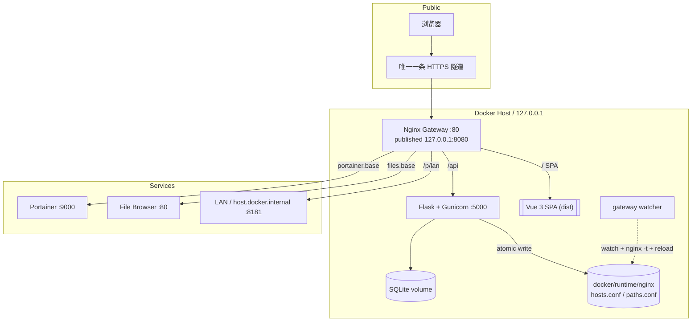
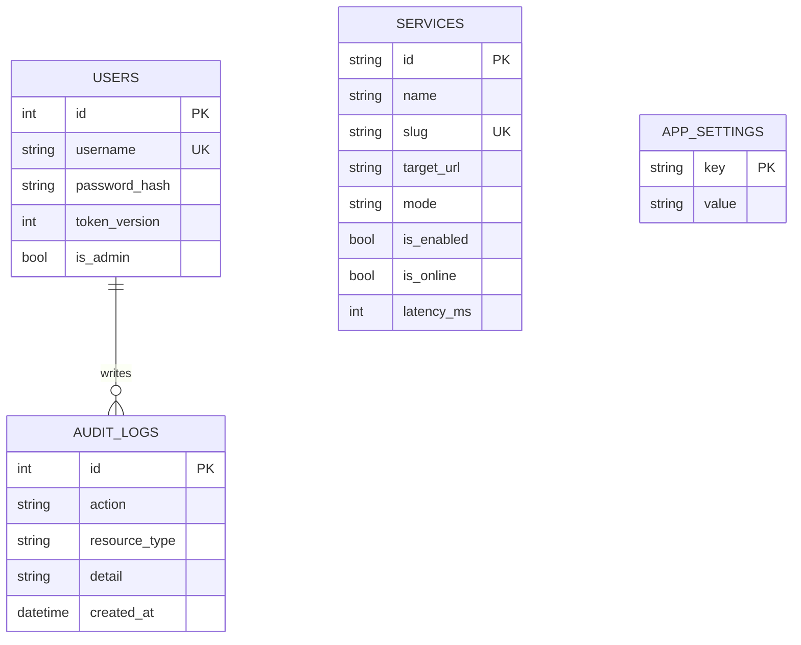

# 架构设计

## 1. 目标与约束

XiLiServerSwitchManageSystem 解决一个非常具体的部署约束：

- 只有**一条**内网穿透隧道；
- 需要暴露**多个** HTTP 服务；
- 服务可能运行在 Docker 容器、宿主机或局域网其他机器；
- 用户希望点击面板卡片就进入目标服务，而不是复制 `localhost:端口`；
- 新增服务不能重启隧道，也不应该重新构建整个系统。

因此，隧道只指向一个稳定的网关，由网关完成二次分发。**隧道数量始终为一。**

## 2. 部署拓扑



### 2.1 组件职责

| 组件 | 职责 | 不负责 |
| --- | --- | --- |
| `gateway` (Nginx) | 唯一公网入口、SPA 静态托管、`/api` 反代、服务 Host/Path 路由、WebSocket、SSE | 业务逻辑、数据库 |
| `backend` (Flask) | 认证、服务 CRUD、设置、审计、健康检查、生成 Nginx 路由片段 | 直接承载公网流量 |
| `frontend` (Vue) | 登录、仪表盘、服务注册表、设置、操作员档案 | 持久化、路由生成 |
| SQLite | 用户、服务、设置、审计记录 | 向量检索等重型数据 |
| `docker/runtime/nginx` | 后端生成的 `hosts.conf` / `paths.conf` | 手写配置 |

## 3. 请求流程

### 3.1 访问控制台

```text
浏览器 -> 隧道 -> Nginx(/)
  -> try_files -> index.html (Vue SPA)
浏览器 -> 隧道 -> Nginx(/api/*) -> Flask
```

- SPA 使用 History 路由，Nginx 对未知路径回退到 `index.html`。
- `/api` 是前后端唯一接口边界。
- 后端只监听容器网络，不发布到宿主机。

### 3.2 访问服务（子域名模式）

```text
浏览器 -> 隧道 -> Nginx(Host: portainer.example.com)
  -> generated server block
  -> proxy_pass http://portainer:9000
```

- 后端把每个启用服务写成独立的 `server` 块。
- `Host` 头保留为公网主机名，便于目标应用生成正确的绝对 URL。
- WebSocket 通过 `Upgrade` / `Connection` 头透传。

### 3.3 访问服务（路径模式）

```text
浏览器 -> 隧道 -> Nginx(/p/portainer/)
  -> location ^~ /p/portainer/
  -> rewrite ^/p/portainer/(.*)$ /$1 break;
  -> proxy_pass http://portainer:9000
```

路径模式是兼容性兜底。对使用绝对路径或 History 路由的单页应用（Portainer、File Browser、Homarr）不保证可用，生产环境优先使用子域名。

### 3.4 本地调试

本机访问控制台时，前端把入口生成形如：

```text
http://portainer.localhost:8080/
```

Chromium / Edge 会把 `*.localhost` 解析到回环地址，因此无需维护 hosts 文件。

## 4. 动态路由

### 4.1 生成

`GatewayService.sync()` 从数据库读取所有服务与设置，生成两个片段：

- `hosts.conf`：`server { server_name ...; location / { proxy_pass ... } }`
- `paths.conf`：`location ^~ /p/<slug>/ { ... }`

写入使用 `write_text_atomic`：同目录临时文件 + `os.replace`，避免 Nginx 读到半截配置。

### 4.2 热加载

网关容器入口 `docker/nginx/entrypoint.sh`：

1. 保证动态目录与空文件存在；
2. 启动 Nginx；
3. 后台每秒对两个文件做 `md5sum`；
4. 哈希变化时先 `nginx -t`，通过则 `nginx -s reload`；
5. 配置非法时保留旧路由并输出错误日志。

这样可以做到：

- 后端不需要 Docker socket；
- 不需要额外的服务发现组件；
- 新增服务 1–2 秒内生效；
- 错误配置不会把网关打挂。

### 4.3 为什么不是重启容器

重启会中断所有已建立连接。Nginx reload 是平滑的：旧 worker 处理完存量请求后退出，新 worker 使用新配置。

## 5. 数据模型



- `services.slug` 唯一，是子域名与路径的唯一标识。
- `users.token_version` 用于撤销旧 JWT；登出/改密时递增。
- `app_settings` 是 key/value 覆盖层，默认值来自 `app/config.py`。
- `audit_logs` 只追加，不在普通界面提供物理删除。

## 6. 认证与安全

- 登录：用户名 + 密码 -> JWT（默认 12h）。
- 密码：Werkzeug `generate_password_hash`。
- 失败锁定：5 次失败锁 15 分钟（按账号）。
- 限流：账号 + IP 的进程内滑动窗口（10 次 / 5 分钟）。
- 令牌撤销：JWT 带 `ver` 声明，与 `users.token_version` 比较。
- 角色：当前版本只有管理员可以修改服务/设置；所有登录用户可查看。
- 审计：登录成功/失败、登出、改密、服务增删改、排序、检测、设置修改。
- 公网入口只绑定 `127.0.0.1`，由隧道访问；后端不对外发布。

> 限流器是进程内的。如果未来横向扩展多个后端实例，需要替换为 Redis 等共享存储。

## 7. 健康检查

- 后台 daemon 线程按 `health_interval` 探测所有启用服务。
- 探测任意 HTTP 响应 < 500 视为在线（401/403 也说明进程存活）。
- 记录 `is_online`、`latency_ms`、`last_checked_at`、`last_error`。
- 手动「立即检测」走同一探测函数，但会额外写审计。
- 网关不做主动健康检查，避免 401 服务被误判为不可用。

## 8. 扩展点

| 需求 | 建议扩展 |
| --- | --- |
| 多用户 / 角色权限 | `users` 增加角色表，API 增加权限装饰器 |
| 多实例后端 | 限流、健康检查迁移到 Redis/独立 worker |
| MySQL / PostgreSQL | 修改 `DATABASE_URL`，使用 Alembic 迁移 |
| 更多路由能力 | 在 `utils/gateway_util/nginx_config_util.py` 增加模板，并在 `docs/API.md` 记录 |
| 主题切换 | 在 `styles/tokens.css` 增加主题变量，登录页与布局读取 CSS 变量 |
| 服务分组 | `services` 增加 `group_id`，前端增加分组视图 |

## 9. 关键取舍

1. **Nginx + 文件监听** 而不是 Traefik：复用成熟的反代能力，避免额外的动态配置服务，Docker 镜像更稳定。
2. **子域名优先** 而不是路径：单页应用在子路径下经常失效，子域名对应用透明。
3. **单实例 SQLite** 而不是 MySQL：开源自托管优先降低依赖；生产规模扩大后可以平滑切换。
4. **服务不做统一鉴权**：各服务有自己的认证模型，网关强行注入会破坏登录流程；安全责任下沉到各服务。
